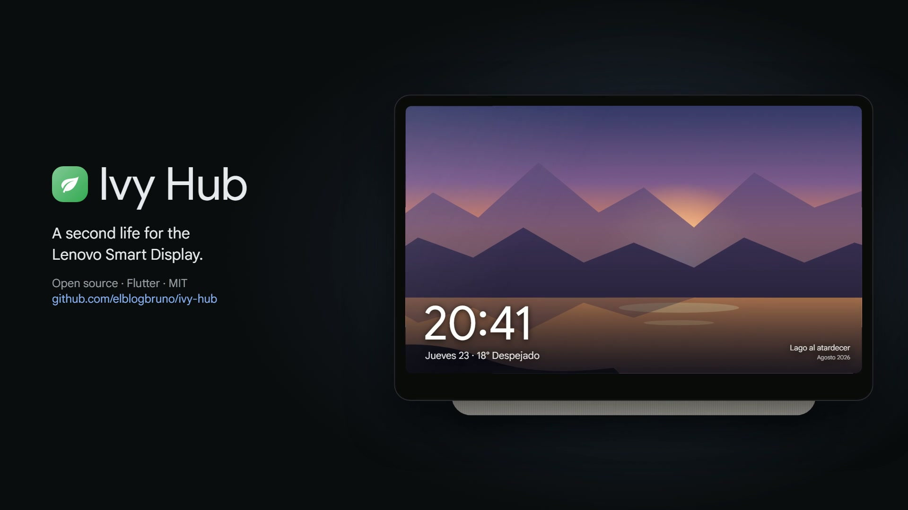

<div align="center">

# 🌿 Ivy Hub

**A second life for the Lenovo Smart Display.**
A native Home Assistant hub, voice assistant and photo frame for the 7″ Lenovo Smart Display (`Ivy`, CD‑17302F), the device Google stopped supporting.


<a href="docs/ivy-hub.mp4"></a>

<sub>▶ Click to watch the 20‑second launch video</sub>

</div>

---

Google dropped the Assistant from its third‑party smart displays and left behind millions of good little screens. Ivy Hub replaces the stock UI with a fast, native Flutter app that talks straight to **Home Assistant**. No browser kiosk and no cloud lock‑in, and it keeps the polish of the original Google Smart Display look.

## ✨ Features

| | |
|---|---|
| 🖼️ **Ambient mode** | Photo slideshow from Home Assistant media (pairs portraits side by side), clock and weather, plus a dim standby clock when the room goes dark, driven by the light and proximity sensors. |
| 🎙️ **Voice assistant** | A built‑in [Wyoming](https://www.home-assistant.io/integrations/wyoming/) satellite: Home Assistant runs wake word, STT, conversation and TTS. Answers can include generated UI cards rendered by a small [OpenUI Lang](https://www.openui.com) runtime. |
| 🏠 **Home control** | Rooms from your HA areas, Google‑Home‑style tiles, a light sheet (brightness, color, white), an arc thermostat, and scenes and scripts. |
| ⚙️ **Configured from HA** | Every tab is a view of an `ivy-app` dashboard. Edit it in Home Assistant and the screen reloads on save. Unknown views render generically from their entities. |
| 🔔 **Doorbell & cameras** | Full‑screen doorbell interrupt with live HLS, a camera wall, and the display's own camera exposed as an MJPEG camera with motion detection. |
| 📞 **Screen‑to‑screen calls** | Video intercom between two Ivy Hubs on the same LAN. |
| 🎵 **Spotify Connect** | A built‑in [librespot](https://github.com/librespot-org/librespot) receiver with transport controls and synced lyrics. |
| ⏰ **Timers & alarms** | Local timers and alarms, plus Home Assistant's native timers through Wyoming. A quiet mode turns things down at night. |
| ⚡ **Energy, parcels, calendars** | Spanish 2.0TD electricity tariff charts (`edata`), 17track parcels, 7‑day agenda and forecast. |
| 📶 **Device tools** | Wi‑Fi setup with an on‑screen keyboard, an ADB‑over‑Wi‑Fi toggle and a volume control. |

## 🧱 How it works

```
┌──────────── Lenovo Smart Display (Android Things 8.1, rooted) ───────────┐
│  Flutter UI ── WebSocket/REST ──────────────▶ Home Assistant              │
│  Wyoming satellite :10700 ◀── wake/STT/TTS ── Assist pipeline             │
│  Local API :2971 (wake, speak, doorbell, camera.mjpeg, calls)            │
│  Kotlin: mic · camera · call audio · librespot · root helpers           │
└──────────────────────────────────────────────────────────────────────────┘
```

## 🚀 Getting started

### Requirements
- A Lenovo Smart Display 7″ flashed to a **rooted userdebug Android Things** build, with ADB enabled.
- Home Assistant with a [long‑lived access token](https://developers.home-assistant.io/docs/auth_api/#long-lived-access-token).
- Flutter 3.41+ and the Android SDK.

### Build & install
```bash
cp secrets.example.json secrets.json     # fill in HA_HOST, HA_TOKEN, CAMERA_TOKEN
flutter build apk --release --target-platform android-arm \
  --dart-define-from-file=secrets.json
adb install -r build/app/outputs/flutter-apk/app-release.apk
```

### Configure from Home Assistant
1. Create the dashboard that drives the tabs: `python tools/setup_ivy_dashboard.py` (edit the example entity ids first).
2. Add the screen with the **Wyoming Protocol** integration (it is found over mDNS, or use `IP:10700`), then pick your Assist pipeline.
3. Optional: name each screen and its room with the device settings `ivy_name` and `ivy_room`.

Detailed voice notes (in Spanish): [`docs/VOICE.es.md`](docs/VOICE.es.md).

### Optional: the Weather Frog 🐸
The Google Weather Frog interlude is supported but its assets aren't shipped. Drop the files from [R0rt1z2/Froggy](https://github.com/R0rt1z2/Froggy) into `assets/froggy/` and rebuild.

## 🔒 Security
- Secrets come in at build time (`--dart-define-from-file`) and are never committed.
- The Wyoming port (10700) and the local API (2971) have no TLS. Keep them on a **trusted LAN** and never forward them from the internet.

## 🧪 Development
```bash
flutter analyze
flutter test        # Wyoming framing and voice/audio flow, on loopback sockets with synthetic audio
```

## 📜 License
[MIT](LICENSE) © 2026 Bruno Moya. Bundled: Google Sans (SIL OFL 1.1, `fonts/OFL.txt`), flare_flutter (MIT), librespot (MIT).

Not affiliated with Lenovo or Google. "Lenovo" and "Google" are trademarks of their respective owners.
